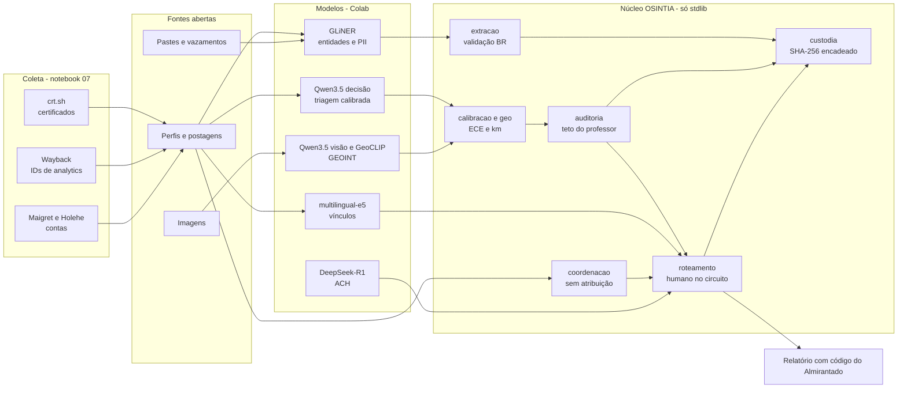

<div align="center">

# OSINTIA

### Modelos de IA para OSINT — reconstruídos, auditáveis e prontos para o Colab

*Qwen3.5 · DeepSeek-R1 · GLiNER · GeoCLIP · multilingual-e5 · Maigret · núcleo em Python puro*

[](LICENSE)
[](https://www.python.org/)
[](osintia/)
[](https://github.com/Ridd1kulusC0d3r/OSINT-Colab/actions/workflows/testes.yml)
[](#)

**[Comece aqui](COMECE-AQUI.md)** · **[Manual ilustrado](docs/manual.html)** · **[Engenharia reversa](docs/ENGENHARIA-REVERSA.md)** · **[Auditoria de rótulos](docs/AUDITORIA-DE-ROTULOS.md)** · **[Modelos](docs/MODELOS.md)** · **[Colabs relacionados](docs/COLABS-RELACIONADOS.md)** · **[Metodologia e ética](docs/METODOLOGIA.md)**

</div>

---

## Por que este repositório existe

Em 2026 a Unsloth publicou um notebook gratuito que transforma o **Qwen3.5 4B** em um **modelo de decisão**: em vez de escrever um parágrafo, o modelo escolhe entre opções definidas antes e devolve **a probabilidade de cada uma**, já calibrada.

Para OSINT isso é enorme. O gargalo de uma investigação em fontes abertas raramente é coletar; é **triar**. Este perfil é legítimo, imitador ou bot? Esta fonte é A ou F? Este IOC vai para bloqueio ou descarte?

Mas a discussão pública sobre o notebook levantou o ponto que todo analista de inteligência deveria levantar: **o gabarito do dataset foi gerado por outro modelo**. Um modelo calibrado contra esse gabarito mede *concordância com o professor*, não verdade. Ele pode chegar a 90% de confiança num erro que o professor também cometeu.

O OSINTIA faz quatro coisas:

1. **Coleta** em fontes abertas (certificados públicos, Wayback Machine, contas por username) e entrega no formato que os modelos leem.
2. **Reconstrói** o notebook de decisão (e outros modelos úteis para OSINT) aplicado a casos reais de triagem, com documentação da engenharia reversa.
3. **Audita o gabarito** antes de confiar no número: teto do professor, lacuna humana e erros herdados.
4. **Fecha o ciclo de inteligência**: humano no circuito, escala do Almirantado, cadeia de custódia com SHA-256 e mascaramento para LGPD.

> **Confiança calibrada não é verdade. É concordância com quem rotulou.**

---

## Notebooks

| # | Notebook | Modelo | O que resolve em OSINT | Hardware | Abrir |
|---|---|---|---|---|---|
| 00 | [Núcleo sem GPU](notebooks/00_nucleo_sem_gpu.ipynb) | — (só stdlib) | Medir confiança: teto do professor, calibração, roteamento, custódia | CPU | [](https://colab.research.google.com/github/Ridd1kulusC0d3r/OSINT-Colab/blob/main/notebooks/00_nucleo_sem_gpu.ipynb) |
| 01 | [Decisão OSINT com Qwen3.5](notebooks/01_decisao_qwen35_osint.ipynb) | `unsloth/Qwen3.5-4B` + LoRA | Triagem de perfis imitadores com probabilidade calibrada e auditoria do gabarito | T4 | [](https://colab.research.google.com/github/Ridd1kulusC0d3r/OSINT-Colab/blob/main/notebooks/01_decisao_qwen35_osint.ipynb) |
| 02 | [Entidades e PII com GLiNER](notebooks/02_gliner_entidades_pii.ipynb) | `urchade/gliner_multi-v2.1` | Extração zero-shot + validação BR (CPF, CNPJ, DDD) + grafo de vínculos | CPU | [](https://colab.research.google.com/github/Ridd1kulusC0d3r/OSINT-Colab/blob/main/notebooks/02_gliner_entidades_pii.ipynb) |
| 03 | [ACH com DeepSeek-R1](notebooks/03_deepseek_r1_ach.ipynb) | `DeepSeek-R1-Distill-Qwen-7B` | Análise de Hipóteses Concorrentes com medida de autoconsistência | T4 | [](https://colab.research.google.com/github/Ridd1kulusC0d3r/OSINT-Colab/blob/main/notebooks/03_deepseek_r1_ach.ipynb) |
| 04 | [Embeddings e vínculos](notebooks/04_embeddings_vinculos.ipynb) | `intfloat/multilingual-e5-base` | Resolução de entidades, contas da mesma pessoa, comportamento coordenado | CPU | [](https://colab.research.google.com/github/Ridd1kulusC0d3r/OSINT-Colab/blob/main/notebooks/04_embeddings_vinculos.ipynb) |
| 05 | [GEOINT com Qwen3.5 visão](notebooks/05_qwen35_visao_geoint.ipynb) | `unsloth/Qwen3.5-4B` (visão) | Pistas de localização em imagens + EXIF, em JSON estruturado | T4 | [](https://colab.research.google.com/github/Ridd1kulusC0d3r/OSINT-Colab/blob/main/notebooks/05_qwen35_visao_geoint.ipynb) |
| 06 | [Decisão sem Unsloth](notebooks/06_decisao_sem_unsloth.ipynb) | `Qwen/Qwen2.5-1.5B-Instruct` | Reconstrução mínima da cabeça de decisão (zero-shot) como linha de base | T4 / CPU | [](https://colab.research.google.com/github/Ridd1kulusC0d3r/OSINT-Colab/blob/main/notebooks/06_decisao_sem_unsloth.ipynb) |
| 07 | [Coleta em fontes abertas](notebooks/07_coleta_fontes_abertas.ipynb) | — (crt.sh, Wayback, Maigret, Holehe) | Variantes de imitação, domínios em certificados, IDs de analytics compartilhados, contas por username | CPU | [](https://colab.research.google.com/github/Ridd1kulusC0d3r/OSINT-Colab/blob/main/notebooks/07_coleta_fontes_abertas.ipynb) |
| 08 | [GeoCLIP auditado](notebooks/08_geoclip_geolocalizacao_auditada.ipynb) | `geoclip` (+ StreetCLIP opcional) | Top-5 coordenadas de uma foto, com calibração medida em quilômetros contra o GPS do EXIF | T4 / CPU | [](https://colab.research.google.com/github/Ridd1kulusC0d3r/OSINT-Colab/blob/main/notebooks/08_geoclip_geolocalizacao_auditada.ipynb) |
| 09 | [Comportamento coordenado](notebooks/09_comportamento_coordenado.ipynb) | — (só stdlib) | Co-link, co-texto e co-repost em janela de tempo; grupos sem atribuição automática | CPU | [](https://colab.research.google.com/github/Ridd1kulusC0d3r/OSINT-Colab/blob/main/notebooks/09_comportamento_coordenado.ipynb) |

Todos os notebooks usam o mesmo caso fictício (uma campanha contra o *Banco Aurora*), gravam as saídas em `/content/saidas/` e registram cada passo num **manifesto de custódia**.

**Fluxo sugerido:** 07 coleta → 01 tria os perfis → 02 extrai entidades → 04 e 09 ligam contas → 05 e 08 localizam imagens → 03 compara hipóteses → relatório.

Quer mais notebooks no mesmo espírito? Veja [docs/COLABS-RELACIONADOS.md](docs/COLABS-RELACIONADOS.md): Bellingcat, GeoCLIP, StreetCLIP, coordination-network-toolkit, Phantomatics e outros, com licença e encaixe no OSINTIA.

---

## Arquitetura



O núcleo (`osintia/`) **não depende de nada além da biblioteca padrão do Python**. Os notebooks instalam as bibliotecas de IA só no Colab.

---

## A descoberta central, em números

O caso de demonstração simula um professor com um vício proposital: todo perfil com **selo de verificado** vira `legitimo`, mesmo quando é um imitador que comprou o selo. Rodando `python -m osintia auditar dados/demo/triagem_perfis.jsonl`:

| Medida | Valor | Leitura |
|---|---|---|
| Teto do professor | **0,915** | Uma nova resposta do professor concorda com o gold 91,5% das vezes |
| Gold × humano | **0,833** | O gabarito acerta só 83,3% contra a verificação humana |
| Imitadores rotulados como legítimos | **59 de 182** | O vício do selo, invisível para a métrica oficial |
| ECE do gold contra ele mesmo | 0,06 | "Calibração ótima" |
| ECE do gold contra o humano | 0,19 | A confiança real é bem pior |

Um aluno que passe de 0,915 de concordância com o gold está **decorando o professor**. O notebook 01 detecta isso automaticamente.

O mecanismo foi apontado publicamente para o dataset original (`LocalLLaMA/typed-decisions`) na análise *A Cheaper Writer* (Substack seldondance). Os números da tabela acima são do nosso caso **sintético**; detalhes e ressalvas em [docs/AUDITORIA-DE-ROTULOS.md](docs/AUDITORIA-DE-ROTULOS.md).

### O mesmo princípio em coordenação e geolocalização

| Caso sintético | O que o OSINTIA mostra |
|---|---|
| **Campanha coordenada** (notebook 09): 3 células de golpe + 60 contas orgânicas + 3 veículos de imprensa | As 3 células são encontradas (cobertura 1,0), mas a imprensa, que compartilha o mesmo comunicado em sequência, **também** aparece como grupo (precisão 0,86). Coordenação não é má-fé; por isso a atribuição é sempre humana. |
| **Geolocalizador superconfiante** (notebook 08): 240 fotos com GPS real | Diz 70% de certeza e acerta a cidade em 50%; ECE de 0,21 no raio de 25 km. Em interiores, acerta 10%. Quando as top-5 ficam espalhadas, o acerto cai de 68% para 19%: um sinal de revisão que não depende da probabilidade declarada. |

---

## Instalação local do núcleo (opcional)

O núcleo roda em qualquer computador com Python 3.9+, sem instalar pacotes:

```bash
git clone https://github.com/Ridd1kulusC0d3r/OSINT-Colab.git
cd OSINT-Colab
python -m unittest discover -s testes -v      # 43 testes
python -m osintia auditar dados/demo/triagem_perfis.jsonl
python -m osintia mascarar "CPF 529.982.247-25 e telefone (31) 98888-7777"
```

Ou dê dois cliques no lançador do seu sistema: `rodar-no-windows.bat`, `rodar-no-mac.command` ou `rodar-no-linux.sh`.

### Uso como biblioteca

```python
from osintia import calibracao, auditoria, roteamento, esquemas

esquemas.validar(esquemas.TRIAGEM_IOC)                       # ([], [])
T = calibracao.ajustar_temperatura(probs_holdout, rotulos)   # temperature scaling
probs = calibracao.aplicar_temperatura(saida_do_modelo, T)
roteamento.rotear(probs, limiar=0.75)                        # 'imitador' ou 'REVISAO_HUMANA'
auditoria.lacuna_humana(previsto, gold, humano)              # quanto do "acerto" é herança

from osintia import coleta, coordenacao, geo
coleta.variantes("bancoaurora")[:5]                          # imitações plausíveis do username
coleta.ids_analytics(html)                                   # {'google_ua': ['UA-...'], ...}
grupos = coordenacao.grupos(coordenacao.grafo(coordenacao.sinais(mensagens)))
geo.acuracia_por_distancia(previstos, gps_reais)             # {'cidade': 0.44, 'pais': 0.56, ...}
```

---

## Estrutura

```
OSINTIA/
├── osintia/                 núcleo stdlib (coleta, calibração, auditoria, roteamento, esquemas, custódia, extração, coordenação, geo)
├── notebooks/               10 notebooks Colab (gerados por ferramentas/gerar_notebooks.py)
├── dados/demo/              casos fictícios: 400 perfis, campanha coordenada (301 mensagens), 240 previsões de geolocalização
├── ferramentas/             geradores e validador dos notebooks
├── testes/                  testes unittest do núcleo
├── docs/                    manual ilustrado, engenharia reversa, modelos, Colabs relacionados, metodologia, relatório de testes
└── rodar-no-*.{bat,command,sh}   lançadores de dois cliques
```

---

## Perguntas OSINT prontas

`osintia.esquemas.CATALOGO` traz cinco esquemas no formato `choice` / `noul` / `score`, validados contra os limites da API (64 perguntas, 255 opções, 10 níveis):

| Esquema | Perguntas |
|---|---|
| `triagem_perfil` | perfil (legítimo / imitador / bot), ação (arquivar / monitorar / escalar) |
| `confiabilidade_fonte` | fonte (escala do Almirantado F→A), corroborada (sim/não) |
| `triagem_ioc` | ação (bloquear / monitorar / descartar), falso positivo (sim/não) |
| `ameaca_postagem` | classe (ameaça real / ruído / sátira), urgência (4 níveis) |
| `triagem_vazamento` | relevância (credencial / dado pessoal / infraestrutura / irrelevante), recente (sim/não) |

---

## Limites honestos

- Os notebooks com GPU foram escritos sobre o código oficial da Unsloth (lido em outubro de 2026) e validados por sintaxe, mas **não foram executados em GPU** neste repositório. As bibliotecas de IA mudam rápido; se algo quebrar, abra uma *issue*. Detalhes em [docs/RELATORIO-DE-TESTES.md](docs/RELATORIO-DE-TESTES.md).
- A coleta (07) depende de serviços públicos que podem ficar lentos ou mudar; o notebook trata as falhas e segue.
- O caso de demonstração é sintético. Ele demonstra o mecanismo, não substitui validação com dados reais.
- Modelos erram com confiança. O OSINTIA existe para que esse erro apareça antes do relatório, não depois.

---

## Créditos e licenças

- Código do OSINTIA: [MIT](LICENSE) · Deivison Lourenço ([@Ridd1kulusC0d3r](https://github.com/Ridd1kulusC0d3r))
- Notebook de decisão original e instalação: [Unsloth](https://github.com/unslothai/notebooks) (LGPL-3.0)
- Dataset `LocalLLaMA/typed-decisions`: Apache-2.0
- Ideias e ferramentas da comunidade: [Bellingcat Open Source Research Notebooks](https://github.com/bellingcat/open-source-research-notebooks), [Maigret](https://github.com/soxoj/maigret), [Holehe](https://github.com/megadose/holehe), [GeoCLIP](https://github.com/VicenteVivan/geo-clip), [coordination-network-toolkit](https://pypi.org/project/coordination-network-toolkit), [Phantomatics](https://github.com/jerzy99jerzy/phantomatics)
- Modelos: ver licenças em [docs/MODELOS.md](docs/MODELOS.md)

Se este trabalho ajudar sua pesquisa, cite usando [CITATION.cff](CITATION.cff).
