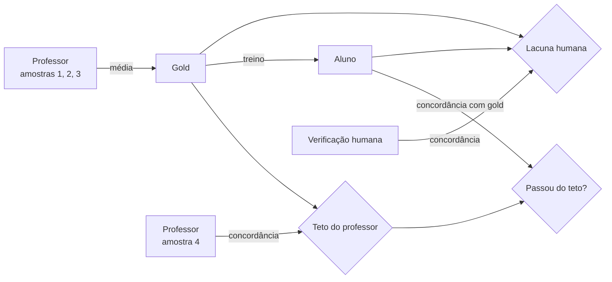

# Auditoria de rótulos: de onde veio a certeza?

## O problema

Um modelo de decisão treinado e calibrado relata, por exemplo, 82% de acurácia e ECE 0,04. Os dois números dependem de uma coisa que quase ninguém verifica: **quem escreveu o gabarito**.

Na discussão pública do notebook da Unsloth, a análise *A Cheaper Writer* (Substack seldondance) afirmou que, no `LocalLLaMA/typed-decisions`:

- o gold é a média de **três amostras de um modelo professor de ~4B**;
- uma nova amostra desse professor concorda com o gold em **0,735** dos 1.600 casos;
- depois de 60 passos, o Qwen3.5 4B concorda com o gabarito **mais do que o professor concorda consigo mesmo**;
- o professor deixou passar uma fatura duplicada (ID igual a uma anterior), e um juiz que pegou a duplicata foi contado como erro.

Esses números são **alegações de terceiros**. Não foram reproduzidos neste repositório, porque o acesso ao Hugging Face não estava disponível no ambiente de construção. O que o OSINTIA faz é reproduzir o **mecanismo** num caso sintético controlado e entregar as ferramentas para você medir no seu próprio dataset.

## Três medidas



| Medida | Função | Pergunta que responde |
|---|---|---|
| **Teto do professor** | `auditoria.teto_do_professor` | Qual o máximo de concordância com o gold que um aluno pode ter sem copiar ruído? |
| **Alerta de decoração** | `auditoria.alerta_de_decoracao` | O aluno passou desse teto? Se sim, aprendeu os vícios do professor. |
| **Lacuna humana** | `auditoria.lacuna_humana` | Quanto da acurácia oficial desaparece quando o juiz é um analista? |
| **Erros herdados** | `auditoria.erros_herdados` | Quais itens a métrica oficial conta como acerto, mas estão errados? |

## O caso de demonstração

`ferramentas/gerar_demo.py` cria 400 perfis fictícios que imitam o *Banco Aurora*. O professor simulado tem 12% de ruído e um vício sistemático: **selo de verificado → `legitimo`**. Resultado (`python -m osintia auditar dados/demo/triagem_perfis.jsonl`):

```
Teto do professor (amostra extra x gold): 0.915
Gold x humano: 0.833 (kappa 0.744)

Matriz (linhas = humano, colunas = gold):
                 bot  imitador  legitimo
bot               79         0         6
imitador           1       122        59
legitimo           1         0       132
```

Os 59 imitadores rotulados como legítimos são o vício do selo. Um aluno perfeito segundo a métrica oficial erra exatamente esses 59, com alta confiança.

## Por que isso é OSINT

Na avaliação de fontes pela escala do Almirantado, separamos:

- **A–F**: a fonte é confiável?
- **1–6**: a informação é verdadeira?

Um modelo calibrado responde bem à segunda pergunta **apenas se** a fonte do gabarito for confiável. Se o rótulo veio de outro modelo, a confiabilidade é herdada, com uma camada de certeza artificial por cima. Trate o gabarito como uma fonte e avalie-o.

## Checklist antes de confiar num modelo de decisão

1. **Proveniência do rótulo.** Humano, modelo ou heurística? Quantas amostras?
2. **Teto do professor.** Sorteie uma resposta nova do rotulador e meça a concordância com o gold.
3. **Amostra humana.** Mesmo 50 itens verificados à mão mostram a lacuna.
4. **Separação.** O conjunto de auditoria nunca entra em treino nem em calibração.
5. **Número de classes.** Poucas classes bem descritas funcionam; taxonomias com dezenas de opções degradam.
6. **Linha de base sem treino.** Compare com o notebook 06: se o *zero-shot* concorda mais com o humano, o problema está no rótulo.
