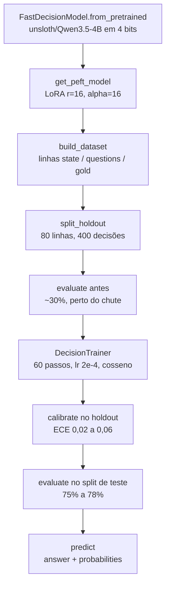

# Engenharia reversa do modelo de decisão da Unsloth

Este documento separa com rigor o que foi **observado** no código público do que foi **inferido** e do que o OSINTIA **reconstruiu**. É a mesma disciplina de qualquer relatório de inteligência: fato, avaliação e lacuna em colunas diferentes.

Fonte primária: `nb/Qwen3_5_(4B)-Decision.ipynb` e `python_scripts/Qwen3_5_(4B)-Decision.py` do repositório [unslothai/notebooks](https://github.com/unslothai/notebooks) (LGPL-3.0), lidos em 10/10/2026. Fonte secundária: documentação *Run and Serve Decision Models Locally with Unsloth: Laya + Jev API* (`unsloth.ai/docs/models/decision-laya`).

---

## 1. O que o notebook original faz (observado)



| Peça | O que o código mostra |
|---|---|
| Classe principal | `FastDecisionModel` e `DecisionTrainer`, importadas de `unsloth` |
| Modelo base | `unsloth/Qwen3.5-4B`, `load_in_4bit=True`, `max_seq_length=2048` |
| Arquitetura | Texto do notebook: o `FastDecisionModel` "adiciona uma cabeça pequena que lê todas as perguntas sobre uma entrada em uma passada e pontua cada opção" |
| Adaptação | LoRA `r=16`, `lora_alpha=16`, `lora_dropout=0`; "a cabeça de decisão nova sempre treina" |
| Dataset | `LocalLLaMA/typed-decisions`, config `all` (1,6 mil linhas; subconjuntos `agent_trace_observability`, `customer_service`, `invoice_processing`, `security_incidents`, 400 linhas cada) |
| Formato da linha | `state` (entrada), `questions` (JSON em texto), `gold` (JSON em texto) |
| Tipos de pergunta | `choice` (uma opção), `noul` (sim/não), `score` (nível ordinal) |
| Treino | batch 8 × acumulação 4, 10 passos de *warmup*, 60 passos (~1,7 época), `lr=2e-4`, cosseno, `weight_decay=0.01` |
| Hardware | T4: ~2 horas, em float32, porque "o Qwen3.5 gera NaN em float16 puro"; RTX PRO 6000: ~12 min; A100 (2 épocas): ~25 min |
| Resultados relatados | 80% a 84% no holdout e ECE 0,02 a 0,06 após calibrar; 75% a 78% no split de teste |
| Saída de `predict` | Por pergunta: `answer` (opção, `True/False` ou nível) e `probabilities` |
| Salvamento | `save_pretrained` grava LoRA, cabeça de decisão **e a calibração** |

Formato de pergunta usado no exemplo oficial (fatura duplicada):

```python
{
    "team":    {"type": "choice", "instructions": "Which team should handle this?",
                "criteria": {"billing": "invoices, payments, refunds", "technical": "bugs, outages, errors", "sales": "pricing, new plans"}},
    "refund":  {"type": "noul",   "instructions": "Does the customer ask for a refund?"},
    "urgency": {"type": "score",  "instructions": "How urgent is this?", "criteria": ["not urgent", "soon", "today"]},
}
```

Formato do `gold` visto no cartão do dataset:

```json
{"action": {"confidence": 0.244444, "label": "human_review", "probabilities": {"...": "..."}, "type": "choice"}}
```

## 2. O que a documentação Laya acrescenta (observado)

- **Laya** e **Clef** são apresentados pela Unsloth como alternativas abertas ao **Jev** (modelo de decisão comercial; a migração usa `typesafe-sdk`). O termo "modelos no estilo Jev" do post original vem daqui.
- Limites da API: até **64 perguntas** por requisição, **255 opções** por `choice`, **10 níveis** por `score`. As descrições das opções dividem um orçamento fixo de tokens: **acima de ~20 opções descritas, os textos são cortados**.
- `confidence` perto de 1 significa uma opção destacada; perto de 0, distribuição espalhada. Para agir, a documentação manda usar o valor em `probabilities`, **não** o `confidence`.
- Limiares do Jev não devem ser reaproveitados na Laya: as confianças são calculadas de formas diferentes.

## 3. O que inferimos (avaliação, não fato)

| Inferência | Base | Confiança |
|---|---|---|
| A calibração é uma forma de *temperature scaling* (ou variante) ajustada no holdout | O método é o padrão da literatura para ECE baixo sem mudar a decisão; `calibrate` recebe só o holdout e é salvo junto do modelo | Moderada |
| A cabeça lê representações ocultas do LLM e projeta por opção, em vez de gerar tokens | "pontua cada opção em uma passada"; as opções vêm com descrições em `criteria` | Moderada |
| O gold é suave (média de amostras) e o treino usa as probabilidades, não só o rótulo | O gold guarda `probabilities` e `confidence` fracionários (0,244444) | Alta |
| Quedas de acurácia com muitas opções vêm em parte do corte de descrições | Limite documentado de ~20 opções descritas; relato de terceiros de 0,42 de acurácia com 77 opções em modelo similar | Baixa a moderada |

## 4. O que o OSINTIA reconstruiu

| Reconstrução | Onde | Por quê |
|---|---|---|
| Esquemas OSINT no mesmo formato `choice`/`noul`/`score`, com validação dos limites | `osintia/esquemas.py` | Trocar o domínio de atendimento ao cliente por triagem de inteligência |
| Gold suave a partir de várias amostras de um professor | `osintia/dados.py` → `gold_de_amostras` | Reproduzir o processo de rotulagem do dataset original |
| Calibração por *temperature scaling* com busca áurea, ECE, Brier, NLL | `osintia/calibracao.py` | Calibrar e medir **fora** da pilha da Unsloth, inclusive contra rótulos humanos |
| Cabeça de decisão artesanal: log-probabilidade de cada opção como continuação | `notebooks/06_decisao_sem_unsloth.ipynb` | Linha de base *zero-shot* que não herda vícios do professor |
| Auditoria de gabarito: teto do professor, lacuna humana, erros herdados | `osintia/auditoria.py` | A peça que o notebook original não tem |
| Separação de um conjunto de auditoria humana **antes** do treino | `notebooks/01_decisao_qwen35_osint.ipynb` | Sem isso, não há como saber se o modelo aprendeu a tarefa ou o professor |

### A cabeça de decisão mínima (notebook 06)

Para cada opção `o` da pergunta, com prompt `x`:

```
pontuação(o) = Σ log P(token_i de o | x, tokens anteriores de o)
P(o | x)     = softmax(pontuação(o)) sobre todas as opções
P_cal(o | x) = softmax(log P(o | x) / T)        # T ajustado no holdout
```

Diferenças para a versão da Unsloth: a nossa faz **uma passada por opção** (a deles, uma por entrada), não treina nada e sofre viés de comprimento quando as opções têm muitos tokens. Em troca, roda com qualquer LLM de chat e não aprende o gabarito.

## 5. Lacunas que continuam abertas

- A arquitetura exata da cabeça (camadas, dimensão, pooling) não aparece no notebook. Só lendo o código-fonte de `unsloth` ou `unsloth_zoo` dá para confirmar.
- Não está documentado como `build_dataset` trata linhas com campos extras; o OSINTIA envia só `state`, `questions` e `gold` para evitar surpresas.
- O número máximo de opções em que o Qwen3.5 4B continua útil não foi medido publicamente. Vale testar com o seu próprio esquema antes de produção.
